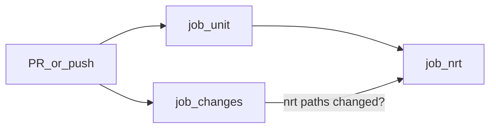

# SportAI

SportAI is a sports video analysis pipeline. It runs detection / tracking models on a video, stores every prediction in a typed JSON document (`Analysis`), then computes statistics and non-regression metrics on top of that document.

The first implemented sport is **tennis**, with a ball detection model based on TrackNet exported to TorchScript. The architecture is designed so that new sports, models and stats can be added without rewriting the orchestrator.

---

## Table of contents

1. [What this project does](#1-what-this-project-does)
2. [Repository layout](#2-repository-layout)
3. [Core concepts](#3-core-concepts)
4. [Pipeline flow](#4-pipeline-flow)
5. [Analysis: the JSON as source of truth](#5-analysis-the-json-as-source-of-truth)
6. [Models](#6-models)
7. [Stats](#7-stats)
8. [Configuration](#8-configuration)
9. [Installation](#9-installation)
10. [Running the pipeline](#10-running-the-pipeline)
11. [Tools](#11-tools)
12. [Training and exporting a model](#12-training-and-exporting-a-model)
13. [Tests and baselines](#13-tests-and-baselines)
14. [GitHub Actions](#14-github-actions)
15. [Hugging Face assets](#15-hugging-face-assets)
16. [How to extend the project](#16-how-to-extend-the-project)
17. [Troubleshooting](#17-troubleshooting)

---

## 1. What this project does

Given a tennis video and a YAML config, SportAI:

1. Opens the video with OpenCV (`VideoReader`).
2. Builds an empty `TennisAnalysis` object (one frame entry per video frame).
3. Instantiates every model listed in the config (currently `TennisBallModel`).
4. Runs each model. Models write predictions into the analysis frames (e.g. `frame.ball`).
5. Optionally runs stats on the filled analysis.
6. Saves the full analysis as a JSON file, or returns the dict when used from tests.

The important design choice: **the JSON is the only source of truth**. Python classes (`TennisAnalysis`, `TennisFrame`, `TennisBall`, …) are thin wrappers around nested dicts. Reading `frame.ball.position` reads the JSON. Writing `frame.ball = TennisBall.create(...)` writes the JSON. Saving is just `json.dump(analysis.data)`.

---

## 2. Repository layout

```
SportAI/
├── configs/                          # Production pipeline configs
│   └── tennis_config.yaml
├── pipeline/                         # Inference / analysis runtime
│   ├── run.py                        # Orchestrator (CLI entrypoint)
│   ├── video_reader.py               # OpenCV video wrapper
│   ├── models/
│   │   ├── model.py                  # Abstract Model base class
│   │   └── tennis/
│   │       └── tennis_ball_model.py  # TrackNet TorchScript ball detector
│   ├── objects/                      # Typed views over the analysis JSON
│   │   ├── analysis.py               # Analysis[FrameT] base
│   │   ├── frame.py / ball.py / player_at_frame.py
│   │   └── tennis/
│   │       ├── tennis_analysis.py
│   │       ├── tennis_frame.py
│   │       ├── tennis_ball.py
│   │       └── tennis_player_at_frame.py
│   └── stats/
│       ├── stat.py                   # Abstract Stat base class
│       └── tennis/
│           └── example_stat.py
├── tests/
│   ├── assets.py                     # Local files or Hugging Face download
│   ├── baseline.py                   # Build / compare metric baselines
│   ├── conftest.py                   # pytest --update-baseline
│   ├── evaluation/                   # Shared evaluators (used by unit + NRT)
│   │   └── ball_tracking.py          # BallTrackingEvaluator
│   ├── unit/                         # Fast pure-logic tests (@pytest.mark.unit)
│   │   ├── test_tennis_ball.py
│   │   ├── test_analysis_json.py
│   │   ├── test_ball_metrics.py
│   │   └── test_baseline.py
│   ├── baselines/tennis/
│   │   └── tennis_ball_tracking.json # Committed reference metrics
│   ├── configs/nrt/tennis/
│   │   └── config_test_tennis_accuracy_ball_tracking.yaml
│   └── nrt/tennis/                   # Slow model NRT (@pytest.mark.nrt)
│       └── test_tennis_accuracy_ball_tracking.py
├── tools/                            # Manual annotation / video helpers
│   ├── ball_anotator.py              # Click ball positions on frames
│   └── video_cuter.py                # Cut clips from a match video
├── trains/                           # Training code (not imported by pipeline)
│   └── tennis/
│       ├── ball_detection/           # TrackNet training + TorchScript export
│       └── player_detection/         # YOLO player detection (WIP)
├── utils/
│   ├── paths.py                      # Project root helper
│   ├── read_yaml.py
│   └── video_downloader.py           # yt-dlp helper
├── scripts/
│   └── render_wiki_home.py           # report.json + nrt-history → Wiki Home.md
├── .github/
│   ├── actions/publish-wiki/         # Composite action: render + push wiki
│   └── workflows/
│       ├── pr-tests.yml              # CI: unit (always) + nrt (filtered)
│       └── nrt-nightly.yml           # Full NRT on main (cron + manual)
├── requirements.txt
├── requirements-test.txt
└── pytest.ini
```

**Separation of concerns**

| Area | Role | Imported by production? |
|------|------|-------------------------|
| `pipeline/` | Run models on videos, produce analysis JSON | Yes |
| `trains/` | Train and export model weights | No (produces `.pt` artefacts only) |
| `tools/` | Human annotation / video cutting GUIs | No |
| `tests/unit/` | Fast pure-logic tests (no video / model / HF) | CI on every PR |
| `tests/nrt/` | Slow model non-regression vs baseline | CI when inference paths change |

Production never imports training code. The only link between `trains/` and `pipeline/` is a TorchScript `.pt` file.

---

## 3. Core concepts

### VideoReader

`pipeline/video_reader.py` wraps `cv2.VideoCapture`.

| Method / attribute | Meaning |
|--------------------|---------|
| `path`, `fps`, `width`, `height`, `frame_count` | Video metadata |
| `info()` | Dict written into the analysis JSON under `"video"` |
| `read_frame(i)` | Seek to frame `i` and return a BGR `np.ndarray` |
| `release()` | Close the capture |

### Model

Every model inherits from `pipeline.models.model.Model`:

```python
class Model(ABC):
    def __init__(self, config: dict) -> None: ...
    def run(self, video_reader: VideoReader, analysis: Analysis) -> None: ...
```

- `__init__(config)` loads weights and stores options (`device`, `threshold`, …).
- `run(...)` reads frames from the video and writes predictions into `analysis.frames`.

Models are loaded dynamically from the config by fully-qualified class path:

```yaml
- name: pipeline.models.tennis.TennisBallModel
```

`run.py` does `importlib.import_module(...)` then instantiates the class with the config dict. Adding a model means creating a class and referencing it in YAML — no change to `run.py`.

### Stat

Same contract as models:

```python
class Stat(ABC):
    def run(self, video_reader: VideoReader, analysis: Analysis) -> None: ...
```

Stats read filled frames (`for frame in analysis.frames`) and write derived values (into `analysis.data["stats"]` or logs). They do not run neural nets.

### Analysis

`Analysis` is a generic container:

```python
class Analysis(ABC, Generic[FrameT]):
    frame_class: type[FrameT]
    frames: list[FrameT]
    data: dict   # the JSON document
```

`TennisAnalysis(Analysis[TennisFrame])` sets `frame_class = TennisFrame`, so every frame is a `TennisFrame` with `.ball` and `.players`.

---

## 4. Pipeline flow

```
CLI / test
   │
   ▼
run_pipeline(sport, video_path, config)
   │
   ├─ VideoReader(video_path)
   ├─ TennisAnalysis.from_video(...)   → empty frames: ball=null, players=[]
   │
   ├─ for each model in config["models"]:
   │      load_class(name)(config)
   │      model.run(video_reader, analysis)   → fills frame.ball / frame.players
   │
   ├─ (optional) for each stat in config["stats"]:
   │      stat.run(video_reader, analysis)
   │
   └─ analysis.save_json(...)   or return analysis.data if test=True
```

CLI:

```bash
python -m pipeline.run \
  --sport tennis \
  --video_path path/to/clip.mp4 \
  --config configs/tennis_config.yaml
```

From Python / tests:

```python
from pipeline.run import run_pipeline
from utils import read_yaml

data = run_pipeline(
    "tennis",
    "path/to/clip.mp4",
    read_yaml("configs/tennis_config.yaml"),
    test=True,   # return the dict instead of saving
)
```

---

## 5. Analysis: the JSON as source of truth

### Document shape

```json
{
  "sport": "tennis",
  "video": {
    "video_path": "...",
    "frame_count": 825,
    "fps": 30.0,
    "height": 720,
    "width": 1280
  },
  "frames": [
    {
      "id": 0,
      "players": [],
      "ball": null
    },
    {
      "id": 3,
      "players": [],
      "ball": {
        "position": [702, 492],
        "confidence": 0.6467
      }
    }
  ]
}
```

### Object mapping

| JSON path | Python class | Access pattern |
|-----------|--------------|----------------|
| root | `TennisAnalysis` | `analysis.data`, `analysis.frames` |
| `frames[i]` | `TennisFrame` | `frame.id`, `frame.ball`, `frame.players` |
| `frames[i].ball` | `TennisBall` | `frame.ball.position`, `frame.ball.confidence` |
| `frames[i].players[j]` | `TennisPlayerAtFrame` | (ready for player detection) |

Each class keeps a reference to its dict (`self.data`). Properties read/write that dict. There is no separate serialization step.

### Writing a ball from a model

```python
# Preferred: replace the whole ball object
analysis.frames[i].ball = TennisBall.create(
    position=(x, y),
    confidence=conf,
)

# Absence of ball
analysis.frames[i].ball = None
```

Reading later:

```python
for frame in analysis.frames:
    if frame.ball:
        print(frame.id, frame.ball.position, frame.ball.confidence)
```

### Persistence

```python
analysis.save_json("outputs/tennis/stats.json")
analysis = TennisAnalysis.load_json("outputs/tennis/stats.json")
```

`save_json` dumps `self.data`. `load_json` rebuilds the object wrappers around the same structure. Tests and visualization tools can reload a previous run with the same API.

---

## 6. Models

### TennisBallModel

File: `pipeline/models/tennis/tennis_ball_model.py`

| Option | Default | Meaning |
|--------|---------|---------|
| `weight` | required | Path to a TorchScript `.pt` file |
| `device` | `"cpu"` | `"cuda"` / `"cuda:0"` / `"cpu"`. Falls back to CPU if CUDA is unavailable |
| `threshold` | `0.5` | Heatmap binarization threshold |
| `input_size` | `(288, 512)` | Model input `(H, W)` |

**Inference logic**

1. For each frame `i`, build a triplet `(i-1, i, i+1)` (edges clamp to the first/last frame).
2. Convert BGR → RGB, resize to `512×288`, concatenate channels → tensor `(1, 9, 288, 512)`.
3. Run the TorchScript model → 3 heatmaps; keep the middle one (current frame).
4. Extract the largest contour centroid above the threshold.
5. Rescale coordinates from model space back to original video resolution.
6. Write `TennisBall.create(position=(x, y), confidence=max_heatmap)` into the frame.

**Why TorchScript?**  
Training code lives under `trains/` and pulls datasets, losses, optimizers, etc. Production only needs the exported graph. That keeps the deployment surface small and stable.

---

## 7. Stats

Stats consume a filled `Analysis`. Example:

```python
class ExampleStat(Stat):
    def run(self, video_reader, analysis: TennisAnalysis) -> None:
        for frame in analysis.frames:
            if frame.ball:
                logger.info(f"frame {frame.id}: ball at {frame.ball.position}")
```

Stats are listed in the YAML under `stats:` the same way as models (the loop in `run.py` can be re-enabled when you add real stats). A typical tennis stat would write values into `analysis.data["stats"]`, for example detection rate or estimated ball speed.

---

## 8. Configuration

### Production config — `configs/tennis_config.yaml`

```yaml
models:
  - name: pipeline.models.tennis.TennisBallModel
    config:
      device: "cuda"
      threshold: 0.5
      weight: "./models/TENNIS_BALL_MODEL_04_11_2026.pt"
outputs:
  path: ./outputs/tennis/stats.json
```

| Key | Meaning |
|-----|---------|
| `models[].name` | Fully-qualified Python class path |
| `models[].config` | Passed to `Model.__init__` |
| `outputs.path` | Where `save_json` writes the analysis |

### Test config — `tests/configs/nrt/tennis/config_test_tennis_accuracy_ball_tracking.yaml`

Extends the production shape with dataset / weights resolution and regression settings:

```yaml
models:
  - name: pipeline.models.tennis.TennisBallModel
    config:
      device: "cuda"          # overridden by SPORTAI_DEVICE=cpu in CI
      threshold: 0.5
      weight: "./models/TENNIS_BALL_MODEL_04_11_2026.pt"
dataset:
  local_dir: ./datasets/tennis/ball_detection/test
  repo_id: rnouteau/sportai-test-data
  revision: v1
  subset: tennis/ball_detection/test
weights:
  repo_id: rnouteau/sportai-models
  filename: tennis/ball/TENNIS_BALL_MODEL_04_11_2026.pt
evaluation:
  min_dist: 10                # pixels: max distance to count a true positive
regression:
  baseline: tests/baselines/tennis/tennis_ball_tracking.json
  metrics: [Accuracy, Precision, Recall, F1-Score]
  tolerance: 0.005
```

Asset resolution (`tests/assets.py`):

1. If the local path exists → use it (dev machine).
2. Otherwise download from Hugging Face Hub (CI).

---

## 9. Installation

### Requirements

- Python 3.11+
- (Optional) CUDA-capable GPU for faster inference
- `ffmpeg` in `PATH` if you use the precise mode of `video_cuter.py`

### Setup

```bash
python -m venv .venv

# Windows
.\.venv\Scripts\Activate.ps1

# Linux / macOS
source .venv/bin/activate

pip install -r requirements.txt
```

For tests / CI extras:

```bash
pip install -r requirements-test.txt
```

On CI (and optionally locally for CPU-only), install the CPU build of PyTorch first:

```bash
pip install torch==2.9.0 --index-url https://download.pytorch.org/whl/cpu
pip install -r requirements-test.txt
```

### Weights

Place the TorchScript ball model at:

```
models/TENNIS_BALL_MODEL_04_11_2026.pt
```

or point `weight:` in the config to another path.  
`.pt` files are gitignored; in CI they are downloaded from Hugging Face.

---

## 10. Running the pipeline

```bash
python -m pipeline.run \
  --sport tennis \
  --video_path datasets/tennis/ball_detection/test/my_clip.mp4 \
  --config configs/tennis_config.yaml
```

Output: `outputs/tennis/stats.json` (path from the config).

Useful checks after a run:

```python
from pipeline.objects.tennis.tennis_analysis import TennisAnalysis

analysis = TennisAnalysis.load_json("outputs/tennis/stats.json")
detected = sum(1 for f in analysis.frames if f.ball)
print(f"{detected}/{len(analysis.frames)} frames with a ball")
```

---

## 11. Tools

### Ball annotator — `tools/ball_anotator.py`

GUI to label ball positions frame by frame.

```bash
python tools/ball_anotator.py --video_path path/to/clip.mp4
```

| Key | Action |
|-----|--------|
| Left click | Set ball position on the current frame |
| `←` / `→` | Previous / next frame |
| `d` | Delete annotation on current frame |
| `s` | Export CSV next to the video (`clip.csv`) |
| `q` | Quit |

CSV format:

```
frame,x,y
0,706.0,480.0
1,704.0,484.0
2,,
3,703.0,493.0
```

- Annotated frames have `x,y`.
- Frames without a ball (or not annotated as present) are exported as empty cells → read as `NaN` by pandas.
- The test suite evaluates **all** CSV rows. `NaN` ground truth + prediction = true negative; `NaN` ground truth + prediction present = false positive.

**Coordinate note:** the annotator displays the frame centered in a 1280×720 canvas without resizing. Pixel coordinates match the video only when the video is 1280×720. For other resolutions, convert using the canvas offset `(640 - width/2, 360 - height/2)`.

### Video cuter — `tools/video_cuter.py`

```bash
python tools/video_cuter.py --video_path path/to/match.mp4
```

Select a start/end frame with the two sliders, then use the File menu:

- **New cut (fast, no re-encode)** — `ffmpeg -c copy` when available.
- **New cut (precise, re-encode)** — re-encodes with libx264 for frame-accurate cuts.

Keyboard: arrows step 1 frame, Shift+arrows ≈ 1 second, Ctrl+arrows ≈ 10 seconds.

### Video downloader — `utils/video_downloader.py`

Thin `yt-dlp` script to download source matches into `downloads/`. Edit `URL` / `MAX_HEIGHT` at the top of the file, then:

```bash
python utils/video_downloader.py
```

---

## 12. Training and exporting a model

Training code lives under `trains/tennis/ball_detection/` (TrackNet family: v2 / v4 / v5 / WASB).  
That package is **not** imported by `pipeline/`.

After training, export a TorchScript artefact:

```bash
cd trains/tennis/ball_detection
python export.py \
  --model_path path/to/checkpoint.pth \
  --output_path ../../../models/TENNIS_BALL_MODEL_04_11_2026.pt \
  --architecture v2
```

`export.py` builds the architecture, loads the state dict, traces with a dummy `(1, C, 288, 512)` tensor, and saves a standalone `.pt` file that `TennisBallModel` loads with `torch.jit.load`.

Player detection training (YOLO) is sketched under `trains/tennis/player_detection/` and is not wired into the pipeline yet.

---

## 13. Tests and baselines

There are two pytest markers (see `pytest.ini`):

| Marker | Folder | Speed | Needs video / weights / HF? | Purpose |
|--------|--------|-------|-----------------------------|---------|
| `unit` | `tests/unit/` | Seconds | No | Pure logic: objects, JSON I/O, metrics, baseline compare |
| `nrt` | `tests/nrt/` | ~15–20 min / clip | Yes | Full pipeline on annotated clips vs committed baseline |

```bash
# Fast feedback while coding
python -m pytest tests/unit -m unit -q

# Slow model non-regression (CPU)
$env:SPORTAI_DEVICE="cpu"   # PowerShell
python -m pytest tests/nrt -m nrt -s -rs
```

### Unit tests (fast)

These never open a video or load TorchScript. Data is built in memory (`dict`, `DataFrame`, pytest `tmp_path`).

| File | What it locks |
|------|----------------|
| `tests/unit/test_tennis_ball.py` | `TennisBall.create`, velocity, dict view |
| `tests/unit/test_analysis_json.py` | `save_json` / `load_json` round-trip, `frame.ball` persistence |
| `tests/unit/test_ball_metrics.py` | `match_prediction` + `compute` (TP / FP1 / FP2 / TN / FN) |
| `tests/unit/test_baseline.py` | `build_baseline`, save/load, `compare_to_baseline` cases |

The evaluator class lives in `tests/evaluation/ball_tracking.py` (`BallTrackingEvaluator`) so unit and NRT tests share the same metric code without importing the NRT entrypoint.

### Philosophy: baseline comparison, not fixed thresholds

The NRT does **not** assert “F1 > 0.80”. It asserts:

> Metrics for every video (and TOTAL) must stay within `tolerance` of the committed baseline.

An improvement that moves a metric outside the tolerance also fails the test. That is intentional: any behaviour change must be reviewed by regenerating and committing the baseline JSON. The git diff of that file shows exactly which videos and metrics moved.

### Metric definitions (`BallTrackingEvaluator`)

For each annotated frame:

| Case | Count |
|------|-------|
| Prediction within `min_dist` px of GT | TP |
| Prediction present but too far from GT | FP1 |
| Prediction present, GT is NaN (no ball) | FP2 |
| No prediction, GT is NaN | TN |
| No prediction, GT has a ball | FN |

Then:

```
Accuracy  = (TP + TN) / Total
Precision = TP / (TP + FP)          where FP = FP1 + FP2
Recall    = TP / (TP + FN)
F1        = 2 * Precision * Recall / (Precision + Recall)
```

### Baseline file

`tests/baselines/tennis/tennis_ball_tracking.json`:

```json
{
  "context": {
    "device": "cpu",
    "dataset_revision": "v1",
    "weights": "TENNIS_BALL_MODEL_04_11_2026.pt",
    "threshold": 0.5,
    "min_dist": 10
  },
  "videos": {
    "clip.mp4": {
      "Accuracy": 0.8715,
      "Precision": 0.9926,
      "Recall": 0.7952,
      "F1-Score": 0.883
    },
    "TOTAL": { "...": "..." }
  }
}
```

The `context` block is compared first. If device, dataset revision, weights, threshold or `min_dist` differ from the baseline, the test fails immediately with a clear message asking you to regenerate — instead of dumping a confusing list of metric drifts caused by a config mismatch.

**CPU vs GPU:** floating-point results are not bit-identical across devices. The CI baseline is generated on CPU (`SPORTAI_DEVICE=cpu`). Always regenerate baselines on the same device class that will verify them.

### Running the NRT locally

```bash
# Use local datasets/ + models/ if present
$env:SPORTAI_DEVICE="cpu"          # PowerShell
python -m pytest tests/nrt/tennis -m nrt -s -rs
```

First run without a baseline (or with `--update-baseline`) writes the baseline and **skips** the test so you cannot mistake “no comparison” for “all green”:

```bash
python -m pytest tests/nrt/tennis -m nrt -s --update-baseline
```

Then commit `tests/baselines/tennis/tennis_ball_tracking.json`.

Reports are written to:

```
outputs/tests/tennis_ball_tracking/report.md
outputs/tests/tennis_ball_tracking/report.json
```

`report.md` shows, per video and metric: current value, baseline, delta, and status (`OK` / `DIFF` / `new baseline`).

### When the model or post-processing changes

1. The NRT turns red and lists the deltas.
2. If the change is intentional, regenerate:
   - locally: `pytest ... --update-baseline` with `SPORTAI_DEVICE=cpu`, or
   - on CI: Actions → **Tests** → Run workflow → check **Regenerate the baseline**.
3. Download / copy the new JSON into `tests/baselines/` and commit it in the same PR.
4. Reviewers see the metric diffs in the PR.

---

## 14. GitHub Actions

Two workflows:

| Workflow | File | Role |
|----------|------|------|
| **Tests** | [`.github/workflows/pr-tests.yml`](.github/workflows/pr-tests.yml) | Unit on every relevant PR/push; NRT only when NRT paths change (or manual) |
| **NRT Nightly** | [`.github/workflows/nrt-nightly.yml`](.github/workflows/nrt-nightly.yml) | Full NRT on `main` every night (no path filter) |

Model scores from the latest NRT on `main` are published to the repository **Wiki → Home** page (auto-generated from `report.json`).

### Tests (`pr-tests.yml`)

| Trigger | When |
|---------|------|
| `pull_request` | Changes under `pipeline/`, `tests/`, `configs/`, `utils/`, requirements, or the workflow itself |
| `push` to `main` | Same |
| `workflow_dispatch` | Manual run; optional `update_baseline` input (NRT job only) |

### Jobs



**1. `unit` (always, ~seconds–minutes)**

- Install `requirements-test.txt` (no separate CPU torch install)
- `python -m pytest tests/unit -m unit -q`
- Fails the PR quickly if pure logic breaks

**2. `changes` (path filter)**

Uses `dorny/paths-filter`. Sets `nrt=true` only when one of these changes:

- `pipeline/models/**`
- `pipeline/run.py`
- `pipeline/video_reader.py`
- `tests/nrt/**`
- `tests/configs/nrt/**`
- `tests/baselines/**`
- `tests/evaluation/**`
- `requirements*.txt`
- `.github/workflows/pr-tests.yml`

A PR that only touches `pipeline/objects/` or `tests/baseline.py` / `tests/unit/` runs **unit only**.

**3. `nrt` (slow, conditional)**

Runs only if:

- `unit` succeeded, **and**
- `workflow_dispatch` **or** the path filter reported NRT-relevant changes

Then:

1. Install CPU torch + `requirements-test.txt`
2. Cache `~/.cache/huggingface`
3. `pytest tests/nrt/tennis -m nrt` with `SPORTAI_DEVICE=cpu`
4. Append `report.md` to the GitHub Step Summary
5. Upload artefacts: report folder + `tests/baselines/tennis/tennis_ball_tracking.json`
6. On `main` only: publish Wiki Home via [`.github/actions/publish-wiki`](.github/actions/publish-wiki)

`update_baseline` from `workflow_dispatch` is passed only to this job.

Required repository secrets:

| Secret | Purpose |
|--------|---------|
| `HF_TOKEN` | Read-only Hugging Face token to download the private dataset and model weights |
| `WIKI_TOKEN` | PAT that can push to the repo wiki (`repo` classic, or fine-grained with wiki write) |

If `HF_TOKEN` is missing (e.g. PR from a fork), the NRT step is skipped with a warning instead of failing.

### NRT Nightly (`nrt-nightly.yml`)

Runs the full ball-tracking NRT on the default branch (`main`) without the path filter.

| Trigger | When |
|---------|------|
| `schedule` | `0 2 * * *` (02:00 UTC daily) |
| `workflow_dispatch` | Manual run from the Actions tab |

Same CPU torch install, HF cache, pytest NRT command, step summary, artefact upload, and **wiki Home publish** as the NRT job in **Tests**. If `HF_TOKEN` is missing, the workflow **fails** (unlike PR forks, where a skip is acceptable).

### Wiki Home (model results)

After each NRT on `main` (nightly, push, or manual), CI regenerates the wiki **Home** page from `outputs/tests/tennis_ball_tracking/report.json` using [`scripts/render_wiki_home.py`](scripts/render_wiki_home.py).

The page includes:

- latest run status and context (device, weights, dataset revision, …)
- a **Mermaid line chart** of TOTAL `F1-Score` vs date (one point per NRT publish)
- a short history table, plus full metrics / TP-FP-TN-FN for the latest run

History is stored in the wiki repo as `nrt-history.json` (not in SportAI git), capped at the last 120 points, with dedup by Actions run URL or commit+day. **PR NRT runs do not update the wiki.**

One-time bootstrap:

1. Repo Settings → Features → enable **Wikis**
2. Create any first page in the Wiki UI (so `*.wiki.git` exists)
3. Add repository secret `WIKI_TOKEN` (PAT with wiki push access)

If `WIKI_TOKEN` is missing or `report.json` was not produced, the publish step warns and skips.

---

## 15. Hugging Face assets

Large binaries are not in git (see `.gitignore`: `*.mp4`, `*.csv`, `*.pt`, `datasets/`).

Expected Hub layout:

```
rnouteau/sportai-test-data          # dataset (private), tag v1
└── tennis/ball_detection/test/
    ├── clip_001.mp4
    └── clip_001.csv

rnouteau/sportai-models             # model repo (private)
└── tennis/ball/
    └── TENNIS_BALL_MODEL_04_11_2026.pt
```

Upload example (Hugging Face CLI `hf` ≥ 2.x):

```bash
pip install -U huggingface_hub
hf auth login

hf repos create rnouteau/sportai-test-data --repo-type dataset --private
hf upload rnouteau/sportai-test-data datasets/tennis/ball_detection/test tennis/ball_detection/test --repo-type dataset
hf repos tag create rnouteau/sportai-test-data v1 --repo-type dataset

hf repos create rnouteau/sportai-models --private
hf upload rnouteau/sportai-models models/TENNIS_BALL_MODEL_04_11_2026.pt tennis/ball/TENNIS_BALL_MODEL_04_11_2026.pt
```

For GitHub Actions, create a **read-only** token at [huggingface.co/settings/tokens](https://huggingface.co/settings/tokens) and store it as the `HF_TOKEN` repository secret.

Keep test clips short (5–15 seconds). On CPU, TrackNet processes only a few frames per second; a long clip makes CI slow.

---

## 16. How to extend the project

### Add a new model (e.g. player detection)

1. Create `pipeline/models/tennis/tennis_player_model.py` inheriting from `Model`.
2. In `run`, write into frames, e.g. via a future `frame.add_player(...)` or by appending to `frame.data["players"]`.
3. Export the class from `pipeline/models/tennis/__init__.py`.
4. Add an entry under `models:` in the YAML:

```yaml
- name: pipeline.models.tennis.TennisPlayerModel
  config:
    weight: ./models/players.pt
    device: cuda
```

No change to `run.py`.

### Add a new stat

1. Create `pipeline/stats/tennis/my_stat.py` inheriting from `Stat`.
2. Read `analysis.frames`, write into `analysis.data.setdefault("stats", {})`.
3. Export it and list it under `stats:` in the config (enable the stats loop in `run.py` if still commented).

### Add a new sport

1. Add `pipeline/objects/<sport>/` with `<Sport>Analysis`, `<Sport>Frame`, and domain objects.
2. Register creation in `run_pipeline` (or, better, load the analysis class from config the same way models are loaded).
3. Add `pipeline/models/<sport>/` and `pipeline/stats/<sport>/`.
4. Add `configs/<sport>_config.yaml` and a test suite under `tests/nrt/<sport>/`.

### Add a new NRT suite

1. Copy the tennis NRT config / test / baseline pattern.
2. Add a matrix line in `.github/workflows/pr-tests.yml` (or a dedicated workflow).
3. Point `dataset` / `weights` / `regression.baseline` at the new assets.

---

## 17. Troubleshooting

| Symptom | Likely cause | Fix |
|---------|--------------|-----|
| `RuntimeError: Attempting to deserialize object on a CUDA device...` | Config asks for `cuda` on a machine without GPU | Already handled by the CPU fallback in `TennisBallModel`; ensure you pull the latest code. Or set `SPORTAI_DEVICE=cpu`. |
| Test shows 0% recall but no exception | Old `run.py` swallowed model errors | Current code re-raises after `logger.exception`. Check the traceback. |
| `FileNotFoundError` on weights in CI | Missing / wrong HF path or token | Verify `weights.filename`, repo visibility, and `HF_TOKEN`. |
| Baseline comparison fails after switching GPU ↔ CPU | Different floating-point paths | Regenerate the baseline on the same device class as CI (`cpu`). |
| `Results differ from the baseline` after a tiny code change | Expected | Inspect `report.md`, then `--update-baseline` if the new behaviour is wanted. |
| Annotator coordinates disagree with predictions | Video not 1280×720 | Convert canvas coords using the centering offset, or resize/export clips at 1280×720. |
| NRT takes ~15–20 min for one 825-frame clip | Three `cap.set` seeks per frame | Known limitation; a sliding-window sequential reader would speed this up. |
| `from tests...` import fails | Another installed package named `tests` | Run via `python -m pytest` from the repo root (`pytest.ini` sets `pythonpath = .`). |
| Cannot commit the baseline JSON | `.gitignore` has `*.json` | Exception already present: `!tests/baselines/**/*.json`. |

---

## Quick reference

```bash
# Install
python -m venv .venv && .\.venv\Scripts\Activate.ps1
pip install -r requirements-test.txt

# Run inference
python -m pipeline.run --sport tennis --video_path clip.mp4 --config configs/tennis_config.yaml

# Annotate a clip
python tools/ball_anotator.py --video_path clip.mp4

# Fast unit tests (no video / model)
python -m pytest tests/unit -m unit -q

# Non-regression test (CPU, slow)
$env:SPORTAI_DEVICE="cpu"
python -m pytest tests/nrt/tennis -m nrt -s -rs

# Refresh baseline after an intentional model change
python -m pytest tests/nrt/tennis -m nrt -s --update-baseline
```
