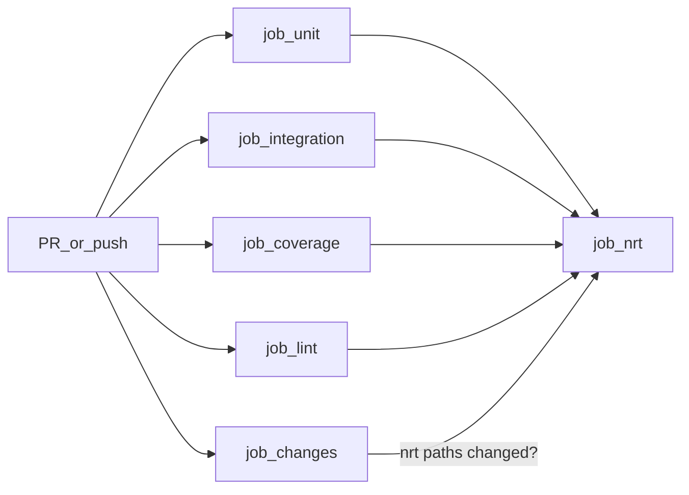

# SportAI

[](https://codecov.io/gh/rnouteau/SportAI)

SportAI is a sports video analysis pipeline. It runs detection / tracking models on a video, stores every prediction in a typed JSON document (`Analysis`), then computes statistics and non-regression metrics on top of that document.

The first implemented sport is **tennis**, with a TrackNet TorchScript **ball** detector, a YOLO **player** detector, and a YOLO11 pose **court** keypoint model (14 ITF points → frame homography). The architecture is designed so that new sports, models and stats can be added without rewriting the orchestrator.

---

## Table of contents

1. [What this project does](#1-what-this-project-does)
2. [Repository layout](#2-repository-layout)
3. [Core concepts](#3-core-concepts)
4. [Pipeline flow](#4-pipeline-flow)
5. [Analysis: the JSON as source of truth](#5-analysis-the-json-as-source-of-truth)
6. [Models](#6-models)
7. [Stats](#7-stats)
8. [Configuration](#8-configuration)
9. [Installation](#9-installation)
10. [Running the pipeline](#10-running-the-pipeline)
11. [Tools](#11-tools)
12. [Training and exporting a model](#12-training-and-exporting-a-model)
13. [Tests and baselines](#13-tests-and-baselines)
14. [Lint and pre-commit](#14-lint-and-pre-commit)
15. [GitHub Actions](#15-github-actions)
16. [Hugging Face assets](#16-hugging-face-assets)
17. [How to extend the project](#17-how-to-extend-the-project)
18. [Troubleshooting](#18-troubleshooting)

---

## 1. What this project does

Given a tennis video and a YAML config, SportAI:

1. Opens the video with OpenCV (`VideoReader`).
2. Builds an empty `TennisAnalysis` object (one frame entry per video frame).
3. Instantiates every model listed in the config (e.g. `TennisBallModel`, `TennisPlayerModel`, `TennisCourtModel`).
4. Runs each model. Models write predictions into the analysis frames (`frame.ball`, `frame.players`, `frame.homography`).
5. Optionally runs stats on the filled analysis.
6. Saves the full analysis as a JSON file, or returns the dict when used from tests.

The important design choice: **the JSON is the only source of truth**. Python classes (`TennisAnalysis`, `TennisFrame`, `TennisBall`, …) are thin wrappers around nested dicts. Reading `frame.ball.position` reads the JSON. Writing `frame.ball = TennisBall.create(...)` writes the JSON. Saving is just `json.dump(analysis.data)`.

---

## 2. Repository layout

```
SportAI/
├── configs/                          # Production pipeline configs
│   └── tennis_config.yaml
├── pipeline/                         # Inference / analysis runtime
│   ├── run.py                        # Orchestrator (CLI entrypoint)
│   ├── video_reader.py               # OpenCV wrapper (read_frame + iter_frames + iter_triplets)
│   ├── device.py                     # resolve_device (config + SPORTAI_DEVICE + CUDA fallback)
│   ├── models/
│   │   ├── model.py                  # Abstract Model[AnalysisT] base
│   │   └── tennis/
│   │       ├── tennis_ball_model.py    # TrackNet TorchScript ball detector
│   │       ├── tennis_player_model.py  # YOLO player detector
│   │       └── tennis_court_model.py   # YOLO11 pose court (14 kpts → homography)
│   ├── objects/                      # Typed views over the analysis JSON
│   │   ├── analysis.py               # Analysis[FrameT] base
│   │   ├── frame.py / ball.py / player_at_frame.py / homography.py
│   │   ├── court_schema.py           # CourtSchema ABC (H + image_to_court + distance)
│   │   ├── position.py               # CourtPosition / ImagePosition
│   │   └── tennis/
│   │       ├── tennis_analysis.py
│   │       ├── tennis_frame.py
│   │       ├── tennis_ball.py
│   │       ├── tennis_player_at_frame.py
│   │       ├── tennis_homography.py
│   │       └── tennis_court_schema.py  # TennisCourtSchema(CourtSchema): ITF + H
│   └── stats/
│       ├── stat.py                   # Abstract Stat[AnalysisT] base
│       └── tennis/
│           ├── tennis_example_stat.py
│           └── tennis_legs_court_stat.py  # player.legs.court via H + analysis.court_schema


├── tests/
│   ├── assets.py                     # Local files or Hugging Face download
│   ├── baseline.py                   # Build / compare metric baselines
│   ├── conftest.py                   # pytest --update-baseline
│   ├── helpers.py                    # Shared test helpers (e.g. make_synthetic_video)
│   ├── evaluation/                   # Shared evaluators (unit + integration + NRT)
│   │   ├── ball_detection_evaluation.py
│   │   ├── player_detection_evaluation.py
│   │   └── court_detection_evaluation.py
│   ├── unit/                         # Fast pure-logic tests (@pytest.mark.unit)
│   │   ├── test_tennis_ball.py
│   │   ├── test_analysis_json.py
│   │   ├── test_frame_empty.py
│   │   ├── test_ball_metrics.py
│   │   ├── test_ball_metrics_properties.py
│   │   ├── test_player_detection_metrics.py
│   │   ├── test_court_detection_metrics.py
│   │   ├── test_court_yolo.py
│   │   ├── test_court_homography.py
│   │   ├── test_resolve_device.py
│   │   ├── test_run_pipeline_analysis.py
│   │   └── test_baseline.py
│   ├── integration/                  # Medium tests (@pytest.mark.integration)
│   │   ├── test_video_reader.py
│   │   ├── test_run_pipeline_fake_model.py
│   │   ├── test_ball_tracking_evaluator_flow.py
│   │   ├── test_player_detection_evaluator_flow.py
│   │   └── test_court_detection_evaluator_flow.py
│   ├── baselines/tennis/
│   │   ├── tennis_ball_detection.json
│   │   ├── tennis_player_detection.json
│   │   └── tennis_court_detection.json
│   ├── configs/nrt/tennis/
│   │   ├── config_test_tennis_accuracy_ball_detection.yaml
│   │   ├── config_test_tennis_accuracy_players_detection.yaml
│   │   └── config_test_tennis_accuracy_court_detection.yaml
│   └── nrt/                          # Slow model NRT (@pytest.mark.nrt)
│       ├── harness.py                # Shared prepare_config / report / assert vs baseline
│       └── tennis/
│           ├── test_tennis_accuracy_ball_detection.py
│           ├── test_tennis_accuracy_players_detection.py
│           └── test_tennis_accuracy_court_detection.py
├── models/                           # Local pipeline / annotator weights (gitignored)
│   ├── based_models/                 # e.g. yolo11s.pt for player annotator pre-label
│   └── trained_models/               # Optional stable copies for pipeline `weight:` paths
├── tools/                            # Manual annotation / video helpers
│   ├── ball_anotator.py              # Click ball positions on frames
│   ├── player_annotator.py           # Draw player bboxes (+ YOLO pre-annotate)
│   ├── court_yolo.py                 # Shared YOLO-pose encode/decode for court labels
│   ├── court_annotator.py            # Label court keypoints → .txt (+ CSV) + overlay
│   └── video_cuter.py                # Cut clips / export a still frame
├── trains/                           # Training code (not imported by pipeline)
│   └── tennis/
│       ├── player_detection/         # YOLO player (prepare + train + MLflow)
│       └── court_detection/          # YOLO11 pose court (14 kpts, NDJSON + train)
├── utils/
│   ├── paths.py                      # Project root helper
│   ├── read_yaml.py
│   └── video_downloader.py           # yt-dlp helper
├── scripts/
│   └── render_wiki_home.py           # report.json + nrt-history → Wiki Home.md (F1 charts only)
├── .github/
│   ├── actions/publish-wiki/         # Composite action: render + push wiki
│   └── workflows/
│       ├── pr-tests.yml              # CI: unit/lint 3.11–3.12 + integration/coverage 3.11 + nrt
│       └── nrt-nightly.yml           # Full NRT on main (cron + manual)
├── pyproject.toml                    # Ruff + mypy + coverage config
├── .pre-commit-config.yaml           # Local hooks (ruff, mypy, file hygiene)
├── requirements.txt
├── requirements-test.txt             # pytest, hypothesis, pytest-cov, ruff, mypy, pre-commit, HF
└── pytest.ini
```

**Separation of concerns**

| Area | Role | Imported by production? |
|------|------|-------------------------|
| `pipeline/` | Run models on videos, produce analysis JSON | Yes |
| `trains/` | Train and export model weights | No (produces `.pt` artefacts only) |
| `tools/` | Human annotation / video cutting GUIs | No |
| `tests/unit/` | Fast pure-logic tests (no video / model / HF) | CI job `unit` (matrix 3.11–3.12) |
| `tests/integration/` | Synthetic video + fake model + evaluator flow (no HF) | CI job `integration` (3.11) |
| Coverage | unit + integration via `pytest-cov`, fail under 60 % | CI job `coverage` (3.11) + Codecov |
| `tests/nrt/` | Slow model non-regression vs baseline | CI when inference paths change (3.11) |
| Lint / pre-commit | Ruff + mypy (+ file hygiene hooks) | CI job `lint` (matrix 3.11–3.12) |

Production never imports training code. The only link between `trains/` and `pipeline/` is weight files (TorchScript `.pt` for the ball; Ultralytics `.pt` for players and court). Ball TrackNet training/export lives outside this repo today (pipeline only loads the exported TorchScript).

---

## 3. Core concepts

### VideoReader

`pipeline/video_reader.py` wraps `cv2.VideoCapture`.

| Method / attribute | Meaning |
|--------------------|---------|
| `video_path`, `fps`, `width`, `height`, `frame_count` | Video metadata |
| `info()` | Dict written into the analysis JSON under `"video"` |
| `read_frame(i)` | Seek to frame `i` and return a BGR `np.ndarray` (random access) |
| `iter_frames()` | One forward pass: yield `(i, frame)` without per-frame seek |
| `iter_triplets()` | One forward pass: yield `(i, prev, curr, next)` with edge clamping |
| `release()` | Close the capture |

`TennisBallModel` uses `iter_triplets()`; `TennisPlayerModel` / `TennisCourtModel` use `iter_frames()` so YOLO inference does not seek once per frame (major speedup on long clips / NRT).

### Device (`pipeline/device.py`)

All tennis models call `resolve_device(config["device"])`:

1. If `SPORTAI_DEVICE` is set in the environment, it **overrides** the YAML `device` (same knob as NRT/CI).
2. Otherwise use the config value (default `"cpu"`).
3. If the result starts with `cuda` but CUDA is unavailable → fall back to `"cpu"` with a warning.

### Model

Every model inherits from `pipeline.models.model.Model`, which is generic over the analysis type:

```python
class Model(ABC, Generic[AnalysisT]):
    def __init__(self, config: dict) -> None: ...
    def run(self, video_reader: VideoReader, analysis: AnalysisT) -> None: ...


class TennisBallModel(Model[TennisAnalysis]):
    def run(self, video_reader: VideoReader, analysis: TennisAnalysis) -> None: ...
```

- `__init__(config)` loads weights and stores options (`device`, `threshold`, …).
- `run(...)` reads frames from the video and writes predictions into `analysis.frames`.
- The type parameter ties each model to its sport analysis (`TennisAnalysis`, future `FootballAnalysis`, …) so mypy stays aligned with Liskov.

Models are loaded dynamically from the config by fully-qualified class path:

```yaml
- name: pipeline.models.tennis.TennisBallModel
```

`run.py` does `importlib.import_module(...)` then instantiates the class with the config dict. Adding a model means creating a class and referencing it in YAML — no change to `run.py`.

### Stat

Same generic contract as models:

```python
class Stat(ABC, Generic[AnalysisT]):
    def run(self, video_reader: VideoReader, analysis: AnalysisT) -> None: ...


class TennisExampleStat(Stat[TennisAnalysis]):
    def run(self, video_reader: VideoReader, analysis: TennisAnalysis) -> None: ...
```

Stats read filled frames and write derived fields on players/frames (e.g. `player.legs.court`). They do not run neural nets.

### Analysis

`Analysis` is a generic container:

```python
class Analysis(ABC, Generic[FrameT]):
    frame_class: type[FrameT]
    frames: list[FrameT]
    data: dict  # the JSON document
    court_schema: CourtSchema | None  # set on the instance
```

`TennisAnalysis` sets `frame_class = TennisFrame` and `self.court_schema = TennisCourtSchema()` in `__init__`. Empty frames come from `TennisFrame.empty(id)`.

---

## 4. Pipeline flow

```
CLI / test
   │
   ▼
run_pipeline(sport, video_path, config)
   │
   ├─ VideoReader(video_path)
   ├─ load_class(config["analysis"]).from_video(...)
   │      → frames via frame_class.empty(i)  (tennis: ball=null, players=[])
   │
   ├─ for each model in config["models"]:
   │      load_class(name)(config)
   │      model.run(video_reader, analysis)   → fills ball / players / homography
   │
   ├─ for each stat in config["stats"] (optional):
   │      load_class(name)(config)
   │      stat.run(video_reader, analysis)    → before video_reader.release()
   │
   └─ analysis.save_json(...)   or return analysis.data if test=True
```

CLI:

```bash
python -m pipeline.run \
  --sport tennis \
  --video_path path/to/clip.mp4 \
  --config configs/tennis_config.yaml
```

From Python / tests:

```python
from pipeline.run import run_pipeline
from utils import read_yaml

data = run_pipeline(
    "tennis",
    "path/to/clip.mp4",
    read_yaml("configs/tennis_config.yaml"),
    test=True,  # return the dict instead of saving
)
```

---

## 5. Analysis: the JSON as source of truth

### Document shape

```json
{
  "sport": "tennis",
  "video": {
    "video_path": "...",
    "frame_count": 825,
    "fps": 30.0,
    "height": 720,
    "width": 1280
  },
  "frames": [
    {
      "id": 0,
      "players": [],
      "ball": null,
      "homography": null
    },
    {
      "id": 3,
      "players": [
        {
          "position": [120.0, 200.0, 340.0, 560.0],
          "confidence": 0.91,
          "legs": { "court": { "x": 1.2, "y": -4.5 } }
        }
      ],
      "ball": {
        "position": [702, 492],
        "confidence": 0.6467
      },
      "homography": {
        "keypoints": [[120.1, 80.2], "... 14 points ..."],
        "confidences": [0.95, "..."],
        "matrix": [[ "... 3x3 image→metres ..." ]]
      }
    }
  ]
}
```

`homography` is written by `TennisCourtModel`: 14 court keypoints + confidences, plus an OpenCV `matrix` (3×3) mapping **image pixels → court metres** (origin = net centre) when ≥4 confident points allow `findHomography`.

### Object mapping

| JSON path | Python class | Access pattern |
|-----------|--------------|----------------|
| root | `TennisAnalysis` | `analysis.data`, `analysis.frames` |
| `frames[i]` | `TennisFrame` | `frame.id`, `frame.ball`, `frame.players`, `frame.homography` |
| `frames[i].ball` | `TennisBall` | `frame.ball.position`, `frame.ball.confidence` |
| `frames[i].players[j]` | `TennisPlayerAtFrame` | `player.bbox`, `player.confidence`, `player.legs` |
| `frames[i].players[j].legs.court` | `CourtPosition` | `x`, `y` (m), `.distance` (metres to net centre) |
| `frames[i].homography` | `TennisHomography` | `keypoints`, `confidences`, `matrix` |

Each class keeps a reference to its dict (`self.data`). Properties read/write that dict. There is no separate serialization step.

### Writing a ball from a model

```python
# Preferred: replace the whole ball object
analysis.frames[i].ball = TennisBall.create(
    position=(x, y),
    confidence=conf,
)

# Absence of ball
analysis.frames[i].ball = None
```

Reading later:

```python
for frame in analysis.frames:
    if frame.ball:
        print(frame.id, frame.ball.position, frame.ball.confidence)
```

### Persistence

```python
analysis.save_json("outputs/tennis/stats.json")
analysis = TennisAnalysis.load_json("outputs/tennis/stats.json")
```

`save_json` dumps `self.data`. `load_json` rebuilds the object wrappers around the same structure. Tests and visualization tools can reload a previous run with the same API.

---

## 6. Models

### TennisBallModel

File: `pipeline/models/tennis/tennis_ball_model.py`

| Option | Default | Meaning |
|--------|---------|---------|
| `weight` | required | Path to a TorchScript `.pt` file |
| `device` | `"cpu"` | Via `resolve_device` (see §3); `SPORTAI_DEVICE` overrides |
| `threshold` | `0.5` | Heatmap binarization threshold |
| `input_size` | `(288, 512)` | Model input `(H, W)` |

**Inference logic**

1. Walk the video once via `video_reader.iter_triplets()` → `(i, i-1, i, i+1)` with edge clamping.
2. Convert BGR → RGB, resize to `512×288`, concatenate channels → tensor `(1, 9, 288, 512)`.
3. Run the TorchScript model → 3 heatmaps; keep the middle one (current frame).
4. Extract the largest contour centroid above the threshold.
5. Rescale coordinates from model space back to original video resolution.
6. Write `TennisBall.create(position=(x, y), confidence=max_heatmap)` into the frame.

**Why TorchScript?**
Ball training/export lives outside this repo. Production only loads the exported graph (`torch.jit.load` + `map_location` via `resolve_device`), which keeps the deployment surface small and stable.

### TennisPlayerModel

File: `pipeline/models/tennis/tennis_player_model.py`

| Option | Default | Meaning |
|--------|---------|---------|
| `weight` | required | Path to an Ultralytics YOLO `.pt` checkpoint |
| `device` | `"cpu"` | Via `resolve_device` (see §3); `SPORTAI_DEVICE` overrides |
| `input_size` | `(640, 640)` | Stored for reference (Ultralytics uses its own imgsz defaults unless overridden) |

**Inference logic**

1. Walk the video once via `video_reader.iter_frames()`.
2. `YOLO.predict(..., classes=[0], stream=True, device=self.device)` (person / player class).
3. For each box, build `TennisPlayerAtFrame` and assign `frame.players`.

Exported from `pipeline.models.tennis` next to `TennisBallModel`. Production config lists all three models; NRT player suite runs player-only.

### TennisCourtModel

File: `pipeline/models/tennis/tennis_court_model.py`

| Option | Default | Meaning |
|--------|---------|---------|
| `weight` | required | Path to an Ultralytics YOLO11 **pose** `.pt` (14 court keypoints) |
| `device` | `"cpu"` | Via `resolve_device` (see §3); `SPORTAI_DEVICE` overrides |
| `input_size` | `(640, 640)` | Stored for reference (Ultralytics imgsz unless overridden) |

**Inference logic**

1. Walk the video once via `video_reader.iter_frames()`.
2. `YOLO.predict(..., classes=[0], stream=True, device=self.device)` (class `tennis court`).
3. Keep the best instance by mean keypoint confidence; read `keypoints.xy` (14×2).
4. Estimate `H` via `analysis.court_schema.estimate_homography` ; set `homo.matrix` on a `TennisHomography`.

NRT court accuracy uses **still images + YOLO-pose labels** via `CourtDetectionEvaluator` (not `run_pipeline` on video). Pipeline court inference on video is what fills `frame.homography` in production runs.

---

## 7. Stats

Stats consume a filled `Analysis` and run **after** models, **before** `video_reader.release()`.

**`TennisLegsCourtStat`** (enabled in production config) projects each player's `legs.image` (bbox bottom-centre) through `frame.homography.matrix` using `analysis.court_schema`, then sets `player.legs.court` → `CourtPosition` persisted as `legs.court: {x, y}` in metres. Access: `player.legs.court.distance`.

```python
for frame in analysis.frames:
    for player in frame.players:
        if player.legs.court:
            print(frame.id, player.legs.court.distance)
```

List stats under `stats:` like models (FQCN + optional `config`):

```yaml
stats:
  - name: pipeline.stats.tennis.TennisLegsCourtStat
    config: {}
```

---

## 8. Configuration

### Production config — `configs/tennis_config.yaml`

```yaml
analysis: pipeline.objects.tennis.TennisAnalysis
models:
  - name: pipeline.models.tennis.TennisBallModel
    config:
      device: "cuda"
      threshold: 0.5
      weight: "./models/TENNIS_BALL_MODEL_04_11_2026.pt"
  - name: pipeline.models.tennis.TennisPlayerModel
    config:
      device: "cuda"
      weight: "./models/TENNIS_PLAYER_MODEL_17_11_2026.pt"
  - name: pipeline.models.tennis.TennisCourtModel
    config:
      device: "cuda"
      weight: "./models/TENNIS_COURT_MODEL_18_11_2026.pt"
stats:
  - name: pipeline.stats.tennis.TennisLegsCourtStat
    config: {}
outputs:
  path: ./outputs/tennis/stats.json
```

| Key | Meaning |
|-----|---------|
| `analysis` | Fully-qualified `Analysis` class path (required; loaded like models) |
| `models[].name` | Fully-qualified Python class path |
| `models[].config` | Passed to `Model.__init__` |
| `stats[].name` | Optional FQCN stats (same load pattern as models; run before release) |
| `outputs.path` | Where `save_json` writes the analysis |

### NRT configs — `tests/configs/nrt/tennis/`

Each suite extends the production shape with dataset / weights resolution and regression settings. CI overrides `device` via `SPORTAI_DEVICE=cpu`; baselines store `"device": "cpu"`.

**Ball** — `config_test_tennis_accuracy_ball_detection.yaml`:

```yaml
analysis: pipeline.objects.tennis.TennisAnalysis
models:
  - name: pipeline.models.tennis.TennisBallModel
    config:
      device: "cuda"          # overridden by SPORTAI_DEVICE=cpu in CI
      threshold: 0.5
      weight: "./models/TENNIS_BALL_MODEL_04_11_2026.pt"
dataset:
  local_dir: ./datasets/tennis/ball_detection/test
  repo_id: rnouteau/sportai-test-data
  revision: v1
  subset: tennis/ball_detection/test
weights:
  repo_id: rnouteau/sportai-models
  filename: tennis/ball/TENNIS_BALL_MODEL_04_11_2026.pt
evaluation:
  min_dist: 10                # pixels: max distance to count a true positive
regression:
  baseline: tests/baselines/tennis/tennis_ball_detection.json
  metrics: [Accuracy, Precision, Recall, F1-Score]
  tolerance: 0.01
```

**Players** — `config_test_tennis_accuracy_players_detection.yaml`:

```yaml
analysis: pipeline.objects.tennis.TennisAnalysis
models:
  - name: pipeline.models.tennis.TennisPlayerModel
    config:
      device: "cuda"
      weight: "./models/TENNIS_PLAYER_MODEL_17_11_2026.pt"
dataset:
  local_dir: ./datasets/tennis/player_detection/test
  repo_id: rnouteau/sportai-test-data
  revision: v2
  subset: tennis/player_detection/test
weights:
  repo_id: rnouteau/sportai-models
  filename: tennis/player/TENNIS_PLAYER_MODEL_17_11_2026.pt
evaluation:
  iou_threshold: 0.5
regression:
  baseline: tests/baselines/tennis/tennis_player_detection.json
  metrics: [Accuracy, Precision, Recall, F1-Score, mAP50, mAP50-95]
  tolerance: 0.005
```

**Court** — `config_test_tennis_accuracy_court_detection.yaml` (image NRT via `CourtDetectionEvaluator`; no `run_pipeline` / no `analysis:` key):

```yaml
models:
  - name: pipeline.models.tennis.TennisCourtModel
    config:
      device: "cuda"
      weight: "./models/TENNIS_COURT_MODEL_18_11_2026.pt"
dataset:
  local_dir: ./datasets/tennis/court_detection/test
  repo_id: rnouteau/sportai-test-data
  revision: v3
  subset: tennis/court_detection/test
weights:
  repo_id: rnouteau/sportai-models
  filename: tennis/court/TENNIS_COURT_MODEL_18_11_2026.pt
evaluation:
  pck_thresholds: [0.05, 0.1]
  match_threshold: 0.05
  oks_sigma: 0.05
regression:
  baseline: tests/baselines/tennis/tennis_court_detection.json
  metrics: [PCK@0.05, PCK@0.1, OKS, Accuracy, Precision, Recall, F1-Score]
  tolerance: 0.01
```

Asset resolution (`tests/assets.py`):

1. If the local path exists → use it (dev machine).
2. Otherwise download from Hugging Face Hub (CI).

---

## 9. Installation

### Requirements

- Python 3.11+ (CI matrix: 3.11 / 3.12 on `unit` + `lint`; NRT and local default: 3.11)
- (Optional) CUDA-capable GPU for faster inference
- `ffmpeg` in `PATH` if you use the precise mode of `video_cuter.py`

### Setup

```bash
python -m venv .venv

# Windows
.\.venv\Scripts\Activate.ps1

# Linux / macOS
source .venv/bin/activate

pip install -r requirements.txt
```

For tests, lint, coverage, and CI extras (`pytest`, `pytest-cov`, `hypothesis`, `ruff`, `mypy`, `pre-commit`, HF hub, …).
These pins require **Python ≥ 3.11** (`pre-commit` / `mypy` no longer install on 3.10):

```bash
pip install -r requirements-test.txt
pre-commit install   # once per clone: run hooks on every git commit
```

On CI (and optionally locally for CPU-only), install the CPU build of PyTorch first:

```bash
pip install torch==2.9.0 torchvision==0.24.0 --index-url https://download.pytorch.org/whl/cpu
pip install -r requirements-test.txt
```

### Weights

| Role | Path | Notes |
|------|------|--------|
| Ball (TorchScript) | `models/TENNIS_BALL_MODEL_04_11_2026.pt` | Loaded by `TennisBallModel` via `torch.jit.load` |
| Players (YOLO) | `models/TENNIS_PLAYER_MODEL_17_11_2026.pt` | Loaded by `TennisPlayerModel` (HF: `tennis/player/...`) |
| Court (YOLO pose) | `models/TENNIS_COURT_MODEL_18_11_2026.pt` | Loaded by `TennisCourtModel` (HF: `tennis/court/...`) |
| Player YOLO pretrained (annotator) | `models/based_models/yolo11s.pt` | Used by `tools/player_annotator.py` pre-label |
| Player train based / stable | `trains/tennis/player_detection/models/{based_models,trained_models}/` | From `configs/train.yaml` |
| Court train based / stable | `trains/tennis/court_detection/models/{based_models,trained_models}/` | e.g. `yolo11s-pose.pt`, `tennis_court_yolo11s_pose.pt` |

Or point `weight:` in the pipeline config to another path.
`.pt` files and the root `/models/` tree are gitignored (dirs kept via `.gitkeep`); `pipeline/models/` stays tracked. In CI, NRT weights are downloaded from Hugging Face.

---

## 10. Running the pipeline

```bash
python -m pipeline.run \
  --sport tennis \
  --video_path datasets/tennis/ball_detection/test/my_clip.mp4 \
  --config configs/tennis_config.yaml
```

Output: `outputs/tennis/stats.json` (path from the config).

Useful checks after a run:

```python
from pipeline.objects.tennis.tennis_analysis import TennisAnalysis

analysis = TennisAnalysis.load_json("outputs/tennis/stats.json")
detected = sum(1 for f in analysis.frames if f.ball)
print(f"{detected}/{len(analysis.frames)} frames with a ball")
```

---

## 11. Tools

### Ball annotator — `tools/ball_anotator.py`

GUI to label ball positions frame by frame.

```bash
python tools/ball_anotator.py --video_path path/to/clip.mp4
```

| Key | Action |
|-----|--------|
| Left click | Set ball position on the current frame |
| `←` / `→` | Previous / next frame |
| `d` | Delete annotation on current frame |
| `s` | Export CSV next to the video (`clip.csv`) |
| `q` | Quit |

CSV format:

```
frame,x,y
0,706.0,480.0
1,704.0,484.0
2,,
3,703.0,493.0
```

- Annotated frames have `x,y`.
- Frames without a ball (or not annotated as present) are exported as empty cells → read as `NaN` by pandas.
- The test suite evaluates **all** CSV rows. `NaN` ground truth + prediction = true negative; `NaN` ground truth + prediction present = false positive.

**Coordinate note:** the annotator displays the frame centered in a 1280×720 canvas without resizing. Pixel coordinates match the video only when the video is 1280×720. For other resolutions, convert using the canvas offset `(640 - width/2, 360 - height/2)`.

### Player annotator — `tools/player_annotator.py`

GUI to label player bounding boxes. If no CSV exists next to the video, it pre-annotates with YOLO (`models/based_models/yolo11s.pt`, max 2 boxes per frame).

```bash
python tools/player_annotator.py --video_path path/to/clip.mp4
```

| Key | Action |
|-----|--------|
| Drag (click + release) | Add a bbox on the current frame |
| `←` / `→` | Previous / next frame |
| `d` | Delete the bbox under the mouse |
| `s` | Export CSV next to the video (`clip_players.csv`) |
| `q` | Quit |

CSV format (one row per box):

```
frame,class_id,x0,y0,x1,y1
0,0,120.0,200.0,340.0,560.0
```

### Court annotator — `tools/court_annotator.py`

GUI to label **14 ITF tennis court keypoints** on a still image. Schema / flip map live only in [`pipeline/objects/tennis/tennis_court_schema.py`](pipeline/objects/tennis/tennis_court_schema.py) (shared with train prepare/import and NRT eval). Named points + fixed edges; `v` projects via `TennisCourtSchema().estimate_court_to_image`.

```bash
python tools/court_annotator.py --image_path path/to/frame.png
```

| Key | Action |
|-----|--------|
| Click | Place / replace the active point (image coords; Unicode-safe load) |
| Click near an existing point | Select that point |
| `←` / `→` | Previous / next keypoint id |
| `d` | Delete the active point |
| `s` | Save **YOLO-pose** `{stem}.txt` (primary) + secondary `{stem}_court.csv` |
| `v` | Homography overlay (green lines + crosses) in an OpenCV window |
| `q` | Quit |

Reload prefers `{stem}.txt` if present, else legacy `_court.csv`. Encode/decode helpers: [`tools/court_yolo.py`](tools/court_yolo.py).

Point order (guided, far→near): far baseline (DL/SL/SR/DR) → far service + T → near service + T → near baseline (DL/SL/SR/DR). No net-centre keypoint (net is drawn only in the overlay).

### Video cuter — `tools/video_cuter.py`

```bash
python tools/video_cuter.py --video_path path/to/match.mp4
```

Select a start/end frame with the two sliders, then use the File menu:

- **New cut (fast, no re-encode)** — `ffmpeg -c copy` when available.
- **New cut (precise, re-encode)** — re-encodes with libx264 for frame-accurate cuts.
- **Export current frame as image** — writes `{video}_frame_{n}.png` next to the source (shortcut `e`).

Keyboard: arrows step 1 frame, Shift+arrows ≈ 1 second, Ctrl+arrows ≈ 10 seconds.
### Video downloader — `utils/video_downloader.py`

Thin `yt-dlp` script to download source matches into `downloads/`. Edit `URL` / `MAX_HEIGHT` at the top of the file, then:

```bash
python utils/video_downloader.py
```

---

## 12. Training and exporting a model

Training packages under `trains/` are **not** imported by `pipeline/`.

### Ball detection (TrackNet)

Ball **training / TorchScript export are not in this repo** under `trains/` today. Pipeline inference only needs the exported TorchScript at e.g. `models/TENNIS_BALL_MODEL_04_11_2026.pt` (or the HF path `tennis/ball/...`).

### Player detection (YOLO)

Code: `trains/tennis/player_detection/` (dataset prep + Ultralytics train + MLflow).

1. Put clips and annotations under `datasets/tennis/player_detection/videos/`
   (`clip.mp4` + `clip_players.csv` from the player annotator).
2. Place the pretrained checkpoint at
   `trains/tennis/player_detection/models/based_models/yolo11s.pt`
   (the player annotator may still use `models/based_models/yolo11s.pt` for pre-label).
3. Train from the package directory:

```bash
cd trains/tennis/player_detection
python train.py --config configs/train.yaml
```

What it does:

- Builds a YOLO dataset under `datasets/tennis/player_detection/yolo/` (seeded train/val split by video, or temporal chunks if a single video).
- Fine-tunes from `trains/tennis/player_detection/models/based_models/`, writes Ultralytics run dirs under `.../models/trained_models/<name>/`.
- Copies `best.pt` to the stable path
  `trains/tennis/player_detection/models/trained_models/tennis_player_yolo11s.pt`.
- Logs metrics to SQLite `mlflow.db` when `mlflow.enabled: true` in the config.

Inspect runs:

```bash
# from the SportAI repo root
mlflow ui --backend-store-uri sqlite:///mlflow.db
```

After training, copy / upload the stable weights so `TennisPlayerModel` can load them (local `models/` or Hugging Face `tennis/player/...`).

### Court detection (YOLO11 pose, 14 keypoints)

Code: `trains/tennis/court_detection/` (NDJSON import + optional prepare + Ultralytics pose train + MLflow).

Uses the same **14** ITF keypoints / `FLIP_IDX` from `pipeline.objects.tennis.tennis_court_schema` only (no local copies). Task is **pose** (1 class `tennis court` + 14 kpts), not plain detect.

**Primary path — Ultralytics NDJSON export**

1. Place the NDJSON under `datasets/tennis/court_detection/` (default name in config:
   `tennis-court-keypoint-detection (2).ndjson`).
2. Place pretrained COCO pose weights at
   `trains/tennis/court_detection/models/based_models/yolo11s-pose.pt`.
3. Train (downloads images from CDN URLs into `yolo/images/{train,val,test}/`):

```bash
cd trains/tennis/court_detection
python train.py --config configs/train.yaml
```

`pipeline.import_ndjson: true` writes YOLO labels + `data.yaml` with `kpt_shape: [14, 3]` and a corrected L/R `flip_idx` (the NDJSON identity flip map is not used).

**Optional — extra manual images**

Annotate with the court annotator into `datasets/tennis/court_detection/images/` (writes sibling YOLO `{stem}.txt`). Set `pipeline.prepare_dataset: true` (and usually `import_ndjson: false`). `prepare_dataset` prefers existing `.txt`; falls back to legacy `*_court.csv`.

What training does:

- Instantiates `configs/yolo11s-court-pose.yaml` (14 kpts), loads `yolo11s-pose.pt`, then trains.
- Applies **train-time** augmentation from `train.augment` (HSV / mild translate-scale / `fliplr`; mosaic/mixup/rotation/perspective off).
- Copies `best.pt` to
  `trains/tennis/court_detection/models/trained_models/tennis_court_yolo11s_pose.pt`
  and logs to `mlflow.db`.

Quick visual check after training:

```bash
cd trains/tennis/court_detection
python scripts/predict_overlay.py `
  --weights models/trained_models/tennis_court_yolo11s_pose.pt `
  --image_path ../../../datasets/tennis/court_detection/yolo/images/val/some.jpg `
  --show
```

Copy or upload the stable pose weights to the pipeline path (e.g. `models/TENNIS_COURT_MODEL_18_11_2026.pt` or HF `tennis/court/...`) for `TennisCourtModel`.

### Court NRT (local)

Layout expected by the evaluator (YOLO-pose stills, 14 kpts):

```
datasets/tennis/court_detection/test/
  *.jpg|png          # or images/
  *.txt              # sibling labels, or labels/ with same stems
```

Each label line: `cls xc yc w h` then `x y v` × 14 (normalized), same as the NDJSON import.

Metrics (per image + TOTAL): `PCK@0.05`, `PCK@0.1`, `OKS`, Accuracy / Precision / Recall / F1 at `match_threshold` (default 0.05×√(bbox area)). Matching is **by keypoint id** (0–13).

```bash
$env:SPORTAI_DEVICE="cpu"   # or cuda
python -m pytest tests/nrt/tennis/test_tennis_accuracy_court_detection.py -m nrt -s -rs
# first time / intentional model change:
python -m pytest tests/nrt/tennis/test_tennis_accuracy_court_detection.py -m nrt -s --update-baseline
```

Reports: `outputs/tests/tennis_court_detection/report.md` (+ `.json`). Baseline: `tests/baselines/tennis/tennis_court_detection.json`.

---

## 13. Tests and baselines

There are three pytest markers (see `pytest.ini`):

| Marker | Folder | Speed | Needs real video / weights / HF? | Purpose |
|--------|--------|-------|----------------------------------|---------|
| `unit` | `tests/unit/` | Seconds | No | Pure logic: objects, JSON I/O, metrics, baseline compare, Hypothesis |
| `integration` | `tests/integration/` | Seconds–tens of s | No (synthetic OpenCV video + fake model) | `VideoReader`, `run_pipeline`, evaluator flow |
| `nrt` | `tests/nrt/` | Minutes (CPU; faster with `iter_triplets` / `iter_frames`) | Yes | Ball/player video pipeline + court still-image pose vs committed baselines |

```bash
# Fast feedback while coding
python -m pytest tests/unit -m unit -q

# Integration (synthetic video, no HF / TorchScript weights)
python -m pytest tests/integration -m integration -q

# Slow model non-regression (CPU)
$env:SPORTAI_DEVICE="cpu"   # PowerShell
python -m pytest tests/nrt -m nrt -s -rs
```

### Unit tests (fast)

These never open a video or load TorchScript. Data is built in memory (`dict`, `DataFrame`, pytest `tmp_path`).

| File | What it locks |
|------|----------------|
| `tests/unit/test_tennis_ball.py` | `TennisBall.create`, velocity, dict view |
| `tests/unit/test_analysis_json.py` | `save_json` / `load_json` round-trip, `frame.ball` persistence |
| `tests/unit/test_frame_empty.py` | `Frame.empty` / `TennisFrame.empty` templates |
| `tests/unit/test_ball_metrics.py` | `match_prediction` + `compute` (TP / FP1 / FP2 / TN / FN) |
| `tests/unit/test_ball_metrics_properties.py` | Hypothesis: counts sum to Total; metrics stay in `[0, 1]` |
| `tests/unit/test_player_detection_metrics.py` | IoU / greedy match (TP if IoU ≥ 0.5 else FP) + mAP helpers |
| `tests/unit/test_court_detection_metrics.py` | PCK / OKS / per-id keypoint TP-FP-FN, `parse_yolo_pose_label`, `discover_image_label_pairs` |
| `tests/unit/test_court_yolo.py` | Shared YOLO-pose encode/decode (`tools/court_yolo.py`) |
| `tests/unit/test_court_homography.py` | `analysis.court_schema`, `legs.court`, `CourtPosition.from_image` / `.distance` |
| `tests/unit/test_resolve_device.py` | `SPORTAI_DEVICE` override + CUDA→CPU fallback |
| `tests/unit/test_baseline.py` | `build_baseline`, save/load, `compare_to_baseline` cases |
| `tests/unit/test_run_pipeline_analysis.py` | Config `analysis:` required; FQCN loads `TennisAnalysis` |

Shared evaluators live under `tests/evaluation/` (`ball_detection_evaluation.py`, `player_detection_evaluation.py`, `court_detection_evaluation.py`) so unit, integration and NRT tests reuse the same metric code without importing the NRT entrypoints.

### Integration tests (medium)

OpenCV writes a tiny synthetic `.mp4` under pytest `tmp_path` (helper: `tests/helpers.py` → `make_synthetic_video`). A `FakeTennisBallModel` (no `.pt`) is loaded by `run_pipeline` via its fully-qualified class path. No Hugging Face assets.

| File | What it locks |
|------|----------------|
| `tests/integration/test_video_reader.py` | Metadata, `read_frame`, `iter_frames`, `iter_triplets` equivalence |
| `tests/integration/test_run_pipeline_fake_model.py` | `run_pipeline(..., test=True)` writes balls + analysis dict shape |
| `tests/integration/test_ball_tracking_evaluator_flow.py` | Pipeline → `match_prediction` → `compute` (TP/FN/TN/FP2 scenario) |
| `tests/integration/test_player_detection_evaluator_flow.py` | Fake player model → `match_prediction` → `compute` (TP/FN/TN) |
| `tests/integration/test_court_detection_evaluator_flow.py` | Synthetic image + mocked pose → `CourtDetectionEvaluator.run_test` (PCK/OKS/F1) |

### Coverage (`pytest-cov`)

Config: [`pyproject.toml`](pyproject.toml) (`[tool.coverage.run]` / `[tool.coverage.report]`).

| Setting | Value |
|---------|--------|
| Measured | `pipeline/`, `tests.evaluation`, `tests.baseline` |
| Omitted | `pipeline/models/tennis/tennis_ball_model.py` (NRT-only TrackNet), `pipeline/stats/**` |
| CI threshold | `--cov-fail-under=60` (also `fail_under = 60` in config) |

`tennis_player_model.py` is currently included in coverage measurement (YOLO import path); the ball TorchScript model stays omitted.

```bash
python -m pytest tests/unit tests/integration -m "unit or integration" `
  --cov=pipeline --cov=tests.evaluation --cov=tests.baseline `
  --cov-report=term-missing --cov-fail-under=60
```

Use `tests.baseline` (module), not `tests/baseline` (path). The CI job **`coverage`** runs the same command, uploads `coverage.xml`, and sends it to Codecov (badge at the top of this README). Add repository secret `CODECOV_TOKEN` for private repos ([codecov.io](https://codecov.io)).

### Philosophy: baseline comparison, not fixed thresholds

The NRT does **not** assert “F1 > 0.80”. It asserts:

> Metrics for every video (and TOTAL) must stay within `tolerance` of the committed baseline.

An improvement that moves a metric outside the tolerance also fails the test. That is intentional: any behaviour change must be reviewed by regenerating and committing the baseline JSON. The git diff of that file shows exactly which videos and metrics moved.

### Metric definitions (`BallTrackingEvaluator`)

For each annotated frame:

| Case | Count |
|------|-------|
| Prediction within `min_dist` px of GT | TP |
| Prediction present but too far from GT | FP1 |
| Prediction present, GT is NaN (no ball) | FP2 |
| No prediction, GT is NaN | TN |
| No prediction, GT has a ball | FN |

Then:

```
Accuracy  = (TP + TN) / Total
Precision = TP / (TP + FP)          where FP = FP1 + FP2
Recall    = TP / (TP + FN)
F1        = 2 * Precision * Recall / (Precision + Recall)
```

### Metric definitions (`PlayerDetectionEvaluator`)

Per frame, predicted and GT boxes (`xyxy`) are matched greedily by IoU:

| Case | Count |
|------|-------|
| Matched pair with IoU ≥ `iou_threshold` (default 0.5) | TP |
| Prediction with no such match | FP |
| GT box left unmatched | FN |

Also reports `mAP50` / `mAP50-95` as **single-class micro-precision proxies** at IoU thresholds 0.50 and 0.50:0.05:0.95 (not full COCO AP with score sorting / PR curves). Useful for regression; do not treat them as published COCO mAP.

Regression metrics compared to baseline: Accuracy, Precision, Recall, F1-Score, mAP50, mAP50-95.

### Baseline files

Ball — `tests/baselines/tennis/tennis_ball_detection.json`:

```json
{
  "context": {
    "device": "cpu",
    "dataset_revision": "v1",
    "weights": "TENNIS_BALL_MODEL_04_11_2026.pt",
    "threshold": 0.5,
    "min_dist": 10
  },
  "videos": {
    "clip.mp4": {
      "Accuracy": 0.8679,
      "Precision": 0.9917,
      "Recall": 0.7952,
      "F1-Score": 0.883
    },
    "TOTAL": { "...": "..." }
  }
}
```

Players — `tests/baselines/tennis/tennis_player_detection.json` (same shape; context uses player weights / dataset revision `v2` and IoU settings; metrics include mAP).

Court — `tests/baselines/tennis/tennis_court_detection.json` (same shape; context uses court weights / dataset revision `v3`, `match_threshold` / `oks_sigma`; metrics include `PCK@*` / `OKS` / F1). Keys under `videos` are **image** filenames, not clips.

The `context` block is compared first. If device, dataset revision, weights, or evaluation knobs differ from the baseline, the test fails immediately with a clear message asking you to regenerate — instead of dumping a confusing list of metric drifts caused by a config mismatch.

**CPU vs GPU:** floating-point results are not bit-identical across devices. The CI baseline is generated on CPU (`SPORTAI_DEVICE=cpu`). Always regenerate baselines on the same device class that will verify them.

### Running the NRT locally

`tests/nrt/tennis` runs **three** suites (ball + players + court):

```bash
# Use local datasets/ + models/ if present
$env:SPORTAI_DEVICE="cpu"          # PowerShell
python -m pytest tests/nrt/tennis -m nrt -s -rs
```

First run without a baseline (or with `--update-baseline`) writes the baseline(s) and **skips** so you cannot mistake “no comparison” for “all green”:

```bash
python -m pytest tests/nrt/tennis -m nrt -s --update-baseline
```

Then commit:

- `tests/baselines/tennis/tennis_ball_detection.json`
- `tests/baselines/tennis/tennis_player_detection.json`
- `tests/baselines/tennis/tennis_court_detection.json`

Reports are written to:

```
outputs/tests/tennis_ball_detection/report.md
outputs/tests/tennis_ball_detection/report.json
outputs/tests/tennis_player_detection/report.md
outputs/tests/tennis_player_detection/report.json
outputs/tests/tennis_court_detection/report.md
outputs/tests/tennis_court_detection/report.json
```

`report.md` shows, per video/image and metric: current value, baseline, delta, and status (`OK` / `DIFF` / `new baseline`). Player reports also include `mAP50` / `mAP50-95`; court reports include `PCK@*` / `OKS`.

### When the model or post-processing changes

1. The NRT turns red and lists the deltas.
2. If the change is intentional, regenerate:
   - locally: `pytest ... --update-baseline` with `SPORTAI_DEVICE=cpu`, or
   - on CI: Actions → **Tests** → Run workflow → check **Regenerate the baseline**.
3. Download / copy the new JSON into `tests/baselines/` and commit it in the same PR.
4. Reviewers see the metric diffs in the PR.

---

## 14. Lint and pre-commit

Config lives in [`pyproject.toml`](pyproject.toml) (Ruff + mypy) and [`.pre-commit-config.yaml`](.pre-commit-config.yaml).

| Tool | Scope | What it does |
|------|-------|--------------|
| Ruff check | `pipeline/`, `tests/`, `scripts/`, `utils/` | Lint (E/W/F/I/B/UP); `trains/` and `tools/` excluded |
| Ruff format | same | Consistent formatting (`line-length = 100`) |
| Mypy | `pipeline/` only | Type-check; `ignore_missing_imports = true`; not `--strict` yet |
| pre-commit hooks | staged files | `trailing-whitespace`, `end-of-file-fixer`, `check-yaml`, `check-added-large-files`, then ruff + mypy |

Local commands:

```bash
# Same checks as the CI lint job
ruff check pipeline tests scripts utils
ruff format --check pipeline tests scripts utils
mypy --config-file=pyproject.toml pipeline

# Or via pre-commit (after pre-commit install)
pre-commit run --all-files
```

The CI jobs **`unit`**, **`integration`**, **`coverage`** and **`lint`** run in parallel (`unit`/`lint` on 3.11 and 3.12). The NRT job waits for all of them to succeed — if any matrix cell fails, NRT is skipped even when model paths changed.

---

## 15. GitHub Actions

Two workflows:

| Workflow | File | Role |
|----------|------|------|
| **Tests** | [`.github/workflows/pr-tests.yml`](.github/workflows/pr-tests.yml) | `unit`/`lint` matrix 3.11–3.12; `integration`/`coverage` on 3.11; NRT filtered |
| **NRT Nightly** | [`.github/workflows/nrt-nightly.yml`](.github/workflows/nrt-nightly.yml) | Full NRT on `main` every night (Python 3.11, no path filter) |

Model scores from the latest NRT on `main` are published to the repository **Wiki → Home** page (auto-generated charts from ball + player + court `report.json` files).

### Tests (`pr-tests.yml`)

| Trigger | When |
|---------|------|
| `pull_request` | Path-filtered: `pipeline/`, `tests/`, `configs/`, `utils/`, requirements, `pytest.ini`, `pyproject.toml`, `.pre-commit-config.yaml`, or the workflow itself |
| `push` to `main` | **Any** push (no path filter) — unit/integration/coverage/lint always; NRT still gated by the `changes` path filter |
| `workflow_dispatch` | Manual run; optional `update_baseline` input (NRT job only) |

### Jobs



**1. `unit` (always, ~seconds)**

- Matrix: Python **3.11 / 3.12** (`fail-fast: false`)
- Install `requirements-test.txt` (no separate CPU torch install)
- `python -m pytest tests/unit -m unit -q`
- Fails the PR quickly if pure logic breaks

**2. `integration` (always, parallel, Python 3.11 only)**

- `python -m pytest tests/integration -m integration -q`
- Synthetic video + fake model; no HF token required

**3. `coverage` (always, parallel, Python 3.11 only)**

- Re-runs unit + integration with `pytest-cov`
- Fails if total coverage < 60 % (omits TrackNet model + stats; see §13)
- Uploads `coverage.xml` artefact + Codecov

**4. `lint` (always, parallel)**

- Matrix: Python **3.11 / 3.12** (`fail-fast: false`)
- `ruff check` + `ruff format --check` on `pipeline/`, `tests/`, `scripts/`, `utils/`
- `mypy --config-file=pyproject.toml pipeline`
- Same install as unit (`requirements-test.txt`)

**5. `changes` (path filter)**

Uses `dorny/paths-filter`. Sets `nrt=true` only when one of these changes:

- `pipeline/models/**`
- `pipeline/run.py`
- `pipeline/video_reader.py`
- `tests/nrt/**`
- `tests/configs/nrt/**`
- `tests/baselines/**`
- `tests/evaluation/**`
- `requirements*.txt`
- `.github/workflows/pr-tests.yml`

A PR that only touches `pipeline/objects/` or `tests/baseline.py` / `tests/unit/` runs **unit + integration + coverage + lint** (no NRT).

**6. `nrt` (slow, conditional, Python 3.11 only)**

Runs only if:

- `unit`, `integration`, `coverage` and `lint` succeeded, **and**
- `workflow_dispatch` **or** the path filter reported NRT-relevant changes

Then:

1. Install CPU `torch` + `torchvision` + `requirements-test.txt` (Python 3.11)
2. Cache `~/.cache/huggingface` (keyed on ball / players / court NRT configs)
3. `pytest tests/nrt/tennis -m nrt` with `SPORTAI_DEVICE=cpu` (ball + players + court)
4. Append ball / players / court `report.md` files to the GitHub Step Summary
5. Upload artefacts: all three report folders + baseline JSON files
6. On `main` only: publish Wiki Home via [`.github/actions/publish-wiki`](.github/actions/publish-wiki) (ball + player + court reports)

`update_baseline` from `workflow_dispatch` is passed only to this job. Timeout is **90** minutes.

Required repository secrets:

| Secret | Purpose |
|--------|---------|
| `HF_TOKEN` | Read-only Hugging Face token to download the private dataset and model weights |
| `WIKI_TOKEN` | PAT that can push to the repo wiki (`repo` classic, or fine-grained with wiki write) |
| `CODECOV_TOKEN` | Codecov upload token (needed for private repos; optional for public) |

If `HF_TOKEN` is missing (e.g. PR from a fork), the NRT step is skipped with a warning instead of failing.

### NRT Nightly (`nrt-nightly.yml`)

Runs the full tennis NRT (ball + players + court) on the default branch (`main`) without the path filter.

| Trigger | When |
|---------|------|
| `schedule` | `0 2 * * *` (02:00 UTC daily) |
| `workflow_dispatch` | Manual run from the Actions tab |

Same setup as the NRT job in **Tests** (Python **3.11**, CPU torch, HF cache, pytest, step summary, artefacts, **wiki Home publish**). Artefact name is `tennis-nrt-reports-nightly` (PR job uses `tennis-nrt-reports`). If `HF_TOKEN` is missing, the workflow **fails** (unlike PR forks, where a skip is acceptable).

### Wiki Home (model results)

After each NRT on `main` (nightly, push, or manual), CI regenerates the wiki **Home** page from:

- `outputs/tests/tennis_ball_detection/report.json`
- `outputs/tests/tennis_player_detection/report.json` (optional; skipped with a warning if missing)
- `outputs/tests/tennis_court_detection/report.json` (optional; skipped with a warning if missing)

via [`scripts/render_wiki_home.py`](scripts/render_wiki_home.py) and [`.github/actions/publish-wiki`](.github/actions/publish-wiki).

Home is **charts only**:

- short latest-run header (status / commit / Actions link)
- **one Mermaid F1 chart per suite** (TOTAL `F1-Score` over time)

Suite ids in `nrt-history.json`: `tennis_ball_tracking`, `tennis_player_detection`, `tennis_court_detection` (report folders remain `tennis_*_detection`). No metrics tables, counts, or text history on Home.

History is stored in the wiki repo as `nrt-history.json` (not in SportAI git), capped at the last 120 points, with dedup by Actions run URL or commit+day **per suite**. **PR NRT runs do not update the wiki.**

One-time bootstrap:

1. Repo Settings → Features → enable **Wikis**
2. Create any first page in the Wiki UI (so `*.wiki.git` exists)
3. Add repository secret `WIKI_TOKEN` (PAT with wiki push access)

If `WIKI_TOKEN` is missing or `report.json` was not produced, the publish step warns and skips.

---

## 16. Hugging Face assets

Large binaries are not in git (see `.gitignore`: `*.mp4`, `*.csv`, `*.pt`, `datasets/`).

Expected Hub layout:

```
rnouteau/sportai-test-data          # dataset (private)
├── tennis/ball_detection/test/     # *.mp4 + *.csv
├── tennis/player_detection/test/   # *.mp4 + *_players.csv
└── tennis/court_detection/test/    # images + YOLO-pose *.txt (14 kpts)

rnouteau/sportai-models             # model repo (private)
├── tennis/ball/TENNIS_BALL_MODEL_04_11_2026.pt
├── tennis/player/TENNIS_PLAYER_MODEL_17_11_2026.pt
└── tennis/court/TENNIS_COURT_MODEL_18_11_2026.pt
```

Upload example (Hugging Face CLI `hf` ≥ 2.x):

```bash
pip install -U huggingface_hub
hf auth login

hf repos create rnouteau/sportai-test-data --repo-type dataset --private
hf upload rnouteau/sportai-test-data datasets/tennis/ball_detection/test tennis/ball_detection/test --repo-type dataset
hf upload rnouteau/sportai-test-data datasets/tennis/player_detection/test tennis/player_detection/test --repo-type dataset
hf upload rnouteau/sportai-test-data datasets/tennis/court_detection/test tennis/court_detection/test --repo-type dataset
hf repos tag create rnouteau/sportai-test-data v3 --repo-type dataset

hf repos create rnouteau/sportai-models --private
hf upload rnouteau/sportai-models models/TENNIS_BALL_MODEL_04_11_2026.pt tennis/ball/TENNIS_BALL_MODEL_04_11_2026.pt
hf upload rnouteau/sportai-models models/TENNIS_PLAYER_MODEL_17_11_2026.pt tennis/player/TENNIS_PLAYER_MODEL_17_11_2026.pt
hf upload rnouteau/sportai-models models/TENNIS_COURT_MODEL_18_11_2026.pt tennis/court/TENNIS_COURT_MODEL_18_11_2026.pt
```

NRT configs pin dataset revisions separately: **ball → `v1`**, **players → `v2`**, **court → `v3`**. Tag new dataset snapshots when you change a subset.

For GitHub Actions, create a **read-only** token at [huggingface.co/settings/tokens](https://huggingface.co/settings/tokens) and store it as the `HF_TOKEN` repository secret.

Keep test clips short (5–15 seconds). TrackNet on CPU is only a few frames per second; YOLO player NRT is lighter per frame but still adds wall time on long clips. Court NRT is image-based (still adds wall time for pose inference over the test set).

---

## 17. How to extend the project

### Add a new model

Follow the existing patterns (`TennisBallModel`, `TennisPlayerModel`, `TennisCourtModel`):

1. Create `pipeline/models/tennis/tennis_<thing>_model.py` inheriting from `Model[TennisAnalysis]`.
2. Implement `run(self, video_reader, analysis: TennisAnalysis)`.
3. In `run`, write into frames (extend `TennisFrame` / analysis JSON as needed).
4. Export the class from `pipeline/models/tennis/__init__.py`.
5. Add an entry under `models:` in the YAML.

No change to `run.py` for a new *tennis* model.

### Add a new stat

1. Create `pipeline/stats/tennis/my_stat.py` inheriting from `Stat[TennisAnalysis]` (`__init__(self, config=None)`).
2. Implement `run(self, video_reader, analysis: TennisAnalysis)`.
3. Prefer writing derived fields on **frames / players** (see `TennisLegsCourtStat` → `player.legs.court`); only use a top-level bag if the KPI is global.
4. Export it and list it under `stats:` in the config (loop already wired in `run.py`).

### Add a new sport

1. Add `pipeline/objects/<sport>/` with `<Sport>Analysis`, `<Sport>Frame` (override `empty(frame_id)` for the frame JSON template), and domain objects.
2. Point `analysis:` in `configs/<sport>_config.yaml` at the new Analysis FQCN (`run_pipeline` loads it like models — no edit to `run.py`).
3. Add `pipeline/models/<sport>/` and `pipeline/stats/<sport>/`.
4. Add a test suite under `tests/nrt/<sport>/` (reuse [`tests/nrt/harness.py`](tests/nrt/harness.py)).

### Add a new NRT suite

1. Add config / baseline under `tests/configs/nrt/` and `tests/baselines/`.
2. Add a thin test under `tests/nrt/<sport>/` that calls the evaluator + `assert_vs_baseline` from [`tests/nrt/harness.py`](tests/nrt/harness.py) (suite-specific `run_context` extras only).
3. Wire CI: HF cache `hashFiles`, step summary, artefact paths, and `publish-wiki` / `render_wiki_home.py` suite inputs (today each suite is listed explicitly — there is no auto matrix yet).
4. Regenerate the baseline on **CPU** (`SPORTAI_DEVICE=cpu`) to match CI.

---

## 18. Troubleshooting

| Symptom | Likely cause | Fix |
|---------|--------------|-----|
| Want CPU while YAML says `cuda` | Config device vs machine | Set `SPORTAI_DEVICE=cpu` (overrides YAML via `resolve_device` in all tennis models + NRT). Without CUDA, `cuda` already falls back to CPU with a warning. |
| `FileNotFoundError` on weights in CI | Missing / wrong HF path or token | Verify `weights.filename`, repo visibility, and `HF_TOKEN`. |
| Baseline comparison fails after switching GPU ↔ CPU | Different floating-point paths | Regenerate the baseline on the same device class as CI (`cpu`). |
| `Results differ from the baseline` after a tiny code change | Expected (model / post-process / I/O edits) | Inspect `report.md`, then `--update-baseline` on CPU if the new behaviour is wanted. |
| Annotator coordinates disagree with predictions | Video not 1280×720 (ball annotator canvas) | Convert canvas coords using the centering offset, or resize/export clips at 1280×720. |
| NRT still slow on CPU | TrackNet on CPU is heavy (even with `iter_triplets` / `iter_frames`) | Prefer a short clip; GPU locally; CI stays on CPU for baseline stability. |
| NRT job skipped even though model paths changed | Upstream jobs red, or path filter | `unit` / `integration` / `coverage` / `lint` must all be green. Path filter does **not** include `pipeline/objects/**`. |
| `player.legs.court` is `None` | No `homography.matrix`, or stat missing | Need ≥4 confident court kpts for H; enable `pipeline.stats.tennis.TennisLegsCourtStat` in YAML. |
| `No matching distribution for pre-commit==4.7.0` on 3.10 | Pins require Python ≥ 3.11 | Use 3.11+ locally; CI matrix is **3.11 / 3.12** only. |
| `Coverage failure: total … less than fail-under=60` | Real drop, or wrong `--cov` path | Use `--cov=tests.baseline` (module). Omits are in `pyproject.toml`. |
| `from tests...` import fails | Another installed package named `tests` | Run via `python -m pytest` from the repo root (`pytest.ini` sets `pythonpath = .`). |
| pre-commit fails then “files were modified” | Auto-fix hooks (whitespace, ruff format) | Re-stage and commit again; or run `pre-commit run --all-files` once. |
| mypy `[override]` when adding a model/stat | Subclass narrowed `Analysis` without generics | Inherit `Model[TennisAnalysis]` / `Stat[TennisAnalysis]` (see §3). |
| `RuntimeError: operator torchvision::nms does not exist` | `torch` CPU wheel + mismatched `torchvision` from PyPI | Install both from the same index (see §9). |
| Ball NRT fails with small metric drift (~0.005–0.01) | CPU nondeterminism | Inspect `report.md`; ball suite tolerance is `0.01`. Regenerate baseline on CPU only for intentional changes. |

---

## Quick reference

```bash
# Install (CPU torch + torchvision; then test deps)
python -m venv .venv && .\.venv\Scripts\Activate.ps1
pip install torch==2.9.0 torchvision==0.24.0 --index-url https://download.pytorch.org/whl/cpu
pip install -r requirements-test.txt

# Run inference
python -m pipeline.run --sport tennis --video_path clip.mp4 --config configs/tennis_config.yaml

# Annotate a clip
python tools/ball_anotator.py --video_path clip.mp4

# Fast unit tests (no video / model)
python -m pytest tests/unit -m unit -q

# Integration tests (synthetic video, fake model)
python -m pytest tests/integration -m integration -q

# Coverage (unit + integration, fail under 60%)
python -m pytest tests/unit tests/integration -m "unit or integration" `
  --cov=pipeline --cov=tests.evaluation --cov=tests.baseline `
  --cov-report=term-missing --cov-fail-under=60

# Lint (same as CI job lint)
ruff check pipeline tests scripts utils
ruff format --check pipeline tests scripts utils
mypy --config-file=pyproject.toml pipeline
# or: pre-commit run --all-files

# Non-regression test (CPU, slow)
$env:SPORTAI_DEVICE="cpu"
python -m pytest tests/nrt/tennis -m nrt -s -rs

# Refresh baseline after an intentional model change
python -m pytest tests/nrt/tennis -m nrt -s --update-baseline
```
